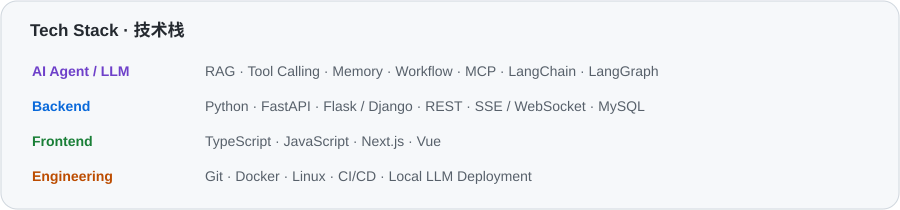
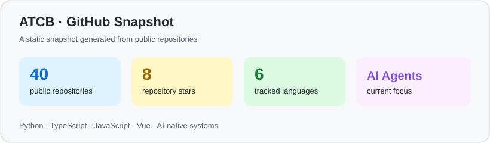

# Hi, I'm ATCB 👋

### AI Agent Engineer · AI-native Systems Builder

  <strong>致力于为智能构建更好的栖居世界。</strong> 
  <em>Building a better inhabitable world for intelligence.</em>

  <a href="https://github.com/ATCBK">GitHub</a> ·
  <a href="https://ycne39nyvm0t.feishu.cn/wiki/ZAGHw86PViMZFckDFBBcxzUDnae">Portfolio / 作品集</a> ·
  <a href="https://yumo.clouddreamai.com/">CloudDream Engine</a> ·
  <a href="mailto:3211840032@qq.com">Email</a>

<strong>语言 / Language</strong> · 点击下方面板切换 · Click a panel below to switch

---

<strong>🇨🇳 中文</strong>

## 关于我

我是一名专注于 AI Agent、LLM 应用和 AI 原生系统的开发者，目前就读于信阳学院人工智能专业，预计 2028 年毕业。

我从课堂之外开始学习真实的软件工程，通过竞赛、黑客松、源码解读和产品实践不断构建自己的能力。我的长期愿景是为智能构建更好的栖居世界。

## 当前构建

### 云梦引擎 · CloudDream Engine

我参与 AI 原生企业级 ERP 系统的开发，担任高级开发，负责核心智能体执行链路优化，关注复杂环境中的工具选择、调用失败、纠偏与恢复。

## 核心项目

### [SparkLearn](https://github.com/ATCBK/SparkLearn)

个性化学习多智能体平台，围绕“画像构建 → 路径规划 → 资源生成 → 学习互动 → 练习评测 → 反馈更新”构建学习闭环，实践 RAG、长期记忆、多智能体协同、多模态交互和 Tutor 工作流。

### [Oh-My-ClaudeCode](https://github.com/ATCBK/Oh-My-ClaudeCode)

解读 Claude Code 的实现思路，并从零手写类 Claude Code 的 Agent Harness，覆盖 Agent Loop、工具注册、权限与 Hooks、Memory、上下文压缩、子代理、Skill、后台任务和 Cron 调度。

## 源码学习与重建

这些项目记录了我对 Agent 系统、上下文工程、事件驱动架构和多智能体运行时的持续学习：

- [learn-claude-code](https://github.com/ATCBK/learn-claude-code) — 从 0 到 1 手写 Claude Code 风格的 Agent Harness
- [learn-dsh-superagent](https://github.com/ATCBK/learn-dsh-superagent) — 深入学习事件驱动、异步多信道、授权、持久化与 Watchdog
- [Learn-Agent-Harness](https://github.com/ATCBK/Learn-Agent-Harness) — Agent Harness 实验与拆解
- [hello-agents-study](https://github.com/ATCBK/hello-agents-study) — 智能体原理与实践学习
- [RelayTown](https://github.com/ATCBK/RelayTown) — 多智能体赛博小镇项目学习
- [Nanobot_new](https://github.com/ATCBK/Nanobot_new) — Nanobot 的功能增强与源码实践
- [Langchian](https://github.com/ATCBK/Langchian) · [SuanFa](https://github.com/ATCBK/SuanFa) · [Harness-Kit](https://github.com/ATCBK/Harness-Kit)

## 产品实验与日常作品

- [LiveAgent](https://github.com/ATCBK/LiveAgent) — 本地优先的跨平台 AI Agent 桌面端
- [PaperFlow](https://github.com/ATCBK/PaperFlow) — 自动化计算机科学研究与论文生成流水线
- [GenAI](https://github.com/ATCBK/GenAI) — 下一代 UI 设计与素材工作流
- [KnowMe](https://github.com/ATCBK/KnowMe) — 了解完整上下文的个人博客与 AI Agent
- [CloudTime](https://github.com/ATCBK/CloudTime) — 时间管理工具
- [SpotPlanningSystem](https://github.com/ATCBK/SpotPlanningSystem) — 基于最短路径思路的景点推荐系统
- [SunMe](https://github.com/ATCBK/SunMe) — 根据天气展示治愈太阳的浏览器插件
- [MoodPet](https://github.com/ATCBK/MoodPet) — 情绪与陪伴方向的实验项目

## 技术栈

  

## 竞赛与经历

- 中国软件杯大学生软件程序设计大赛全国一等奖
- AI 开发者大赛全国亚军
- Agent Skills 开发者大赛全国银奖
- 参与《AI 智能体核心技术剖析》编写
- 科大讯飞 AI 相关项目实习经历

## GitHub 数据

  

## 联系我

  <a href="mailto:3211840032@qq.com">3211840032@qq.com</a> ·
  <a href="https://ycne39nyvm0t.feishu.cn/wiki/ZAGHw86PViMZFckDFBBcxzUDnae">个人作品集</a> ·
  <a href="https://github.com/ATCBK">GitHub</a>

<em>保持好奇，从源码学习，以创造为目的。</em>

<strong>🇬🇧 English</strong>

## About Me

I am an AI-focused developer working on AI Agents, LLM applications, and AI-native systems. I study Artificial Intelligence at Xinyang University and expect to graduate in 2028.

I learn by building: through competitions, hackathons, source-level study, and real product development. My long-term vision is to build a better inhabitable world for intelligence.

## Currently Building

### CloudDream Engine

I work as a senior developer on an AI-native enterprise ERP system, focusing on the reliability of agent execution pipelines, tool selection, failure recovery, and multi-step workflows in complex environments.

## Selected Work

### [SparkLearn](https://github.com/ATCBK/SparkLearn)

A personalized multi-agent learning platform built around the loop of profiling, planning, generation, interaction, evaluation, and feedback. It explores RAG, long-term memory, multi-agent collaboration, multimodal interaction, and Tutor workflows.

### [Oh-My-ClaudeCode](https://github.com/ATCBK/Oh-My-ClaudeCode)

I studied the implementation ideas behind Claude Code and rebuilt a Claude Code-like Agent Harness from scratch. It covers the agent loop, tool registry, permissions and hooks, memory, context compaction, subagents, skills, background tasks, and cron scheduling.

## Source Study & Rebuilding

These repositories document my ongoing study of Agent systems, context engineering, event-driven architecture, and multi-agent runtimes:

- [learn-claude-code](https://github.com/ATCBK/learn-claude-code) — rebuilding a Claude Code-style Agent Harness from zero to one
- [learn-dsh-superagent](https://github.com/ATCBK/learn-dsh-superagent) — studying event-driven execution, async channels, authorization, persistence, and watchdogs
- [Learn-Agent-Harness](https://github.com/ATCBK/Learn-Agent-Harness) — Agent Harness experiments and system breakdowns
- [hello-agents-study](https://github.com/ATCBK/hello-agents-study) — learning Agent principles and practical implementation
- [RelayTown](https://github.com/ATCBK/RelayTown) — learning through a multi-agent cyber-town project
- [Nanobot_new](https://github.com/ATCBK/Nanobot_new) — extending Nanobot through source-level practice
- [Langchian](https://github.com/ATCBK/Langchian) · [SuanFa](https://github.com/ATCBK/SuanFa) · [Harness-Kit](https://github.com/ATCBK/Harness-Kit)

## Product Experiments & Side Projects

- [LiveAgent](https://github.com/ATCBK/LiveAgent) — a local-first cross-platform AI Agent desktop client
- [PaperFlow](https://github.com/ATCBK/PaperFlow) — an automated computer-science research and paper-generation pipeline
- [GenAI](https://github.com/ATCBK/GenAI) — a next-generation UI design and asset workflow
- [KnowMe](https://github.com/ATCBK/KnowMe) — a personal blog and AI Agent that understands full context
- [CloudTime](https://github.com/ATCBK/CloudTime) — a time-management tool
- [SpotPlanningSystem](https://github.com/ATCBK/SpotPlanningSystem) — a shortest-path-based travel recommendation system
- [SunMe](https://github.com/ATCBK/SunMe) — a weather-aware healing-sun browser extension
- [MoodPet](https://github.com/ATCBK/MoodPet) — an experiment around mood and companionship

## Tech Stack

  

## Achievements & Experience

- National First Prize, China Software Cup
- National Runner-up, AI Developer Competition
- National Silver Award, Agent Skills Developer Competition
- Contributor to *Analysis of Core AI Agent Technologies*
- AI engineering internship experience at iFlytek

## GitHub Stats

  

## Contact

  <a href="mailto:3211840032@qq.com">3211840032@qq.com</a> ·
  <a href="https://ycne39nyvm0t.feishu.cn/wiki/ZAGHw86PViMZFckDFBBcxzUDnae">Portfolio</a> ·
  <a href="https://github.com/ATCBK">GitHub</a>

<em>Build with curiosity. Learn from the source. Create with purpose.</em>

